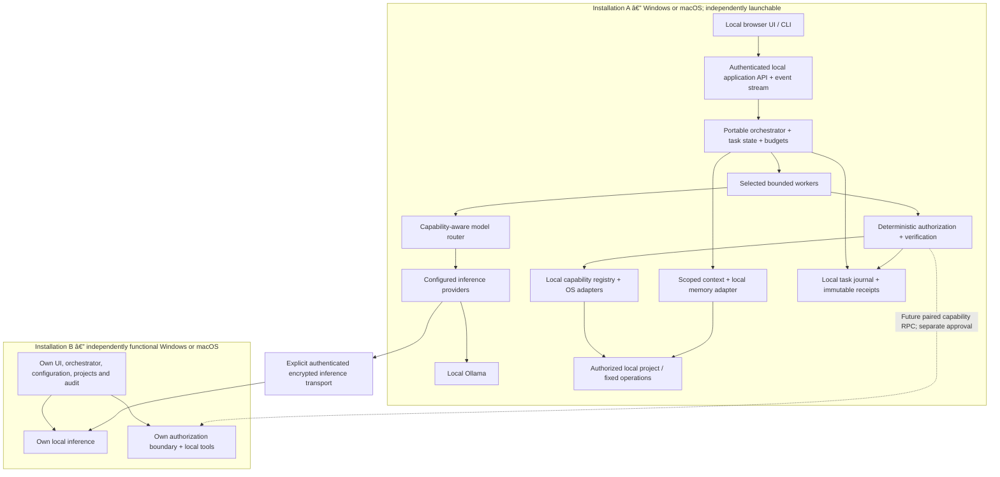

# LocalCodingAgent architecture assessment and phased plan

Proposal for operator review — 2026-11-14. No portable-core extraction, multi-agent scheduler, web server, LAN listener, cloud provider, or remote-control service is implemented by this assessment.

## Decision

Evolve the current Python runner through explicit interfaces and compatibility wrappers. Run the same complete application independently on Windows or macOS. Add optional inference transport between installations without moving execution authority to the model server. Keep remote tool execution a separate, explicitly approved feature with its own security review.

Do not start with a distributed framework or rewrite the existing broker. Preserve the working CLI, strict parser, registered-root restrictions, pinned test executor, single-use permits, memory workflow, audit evidence, and existing Git state during every migration increment.

The narrower historical `MAC_STUDIO_ARCHITECTURE.md` remains useful for the Windows-to-Mac inference boundary. This assessment expands the proposed product to include full standalone macOS operation and possible future reverse-direction scoped capabilities. It does not activate either.

Phase A evidence from this session: the complete suite ran **140 tests, one skipped, no failures/errors**. Two consecutive read-only Qwen 7B trials performed all five required reads, passed three pinned tests, and returned valid summaries including MAPLE-427; each classified `completed_verified`. Fixture/private data and reference history stayed unchanged. The follow-up preserves validated text-call protocol in history and gives an explicit complete-JSON finish example. It does not repair malformed JSON or relax the parser. This validates the bounded fixture workflow, not general model reliability, macOS operation, or distributed execution. Detailed local evidence: `.local/step58/QWEN_CONTINUATION_REPORT.md`.

## 1. Current architecture and component inventory

Repository inspected on `main`, HEAD `98766cb5704496dd9acf32403269352691b062b2`. The current worktree contains the Step 57/Qwen follow-up source, tests, evaluation notes, and pre-existing backup files. No remote fetch, commit, or push was performed during this assessment.

| Component | Current responsibility | Evidence and limitations |
|---|---|---|
| `agent.py` | Operator CLI, fixed project registration, project/inference locks, snapshots, permit issue/consume, run lifecycle, reviewed handoff commands | Single selected project and model; registrations are Windows paths; no task scheduler |
| `local_agent.py:Ollama` | Installed-model validation and bounded local HTTP inference | Loopback IPv4 only, redirects forbidden, no cloud/download fallback; not a generic provider interface |
| `local_agent.py:TOOLS/Broker` | Typed file/search/Git/edit capabilities, fixed subprocess operations, execution receipts | Central authorization boundary; no general shell, OS sandbox, or remote broker |
| `local_agent.py` parser/validation | Strict standalone text-call parsing and native-call schema checks | Conversational JSON and fabricated tool results remain untrusted; execution uses validated calls |
| `local_agent.py:run_agent` | One bounded inference/tool loop, recovery, logs, finish classification, token accounting | Handles one worker-like run; no role registry, DAG, shared budget, durable scheduler, or request cancellation |
| `agent_core.py:Project` | Exact Git-root identity, state/file hashes, guarded path resolution, ancestry/nested instructions, bounded memory | Good execution boundary; filesystem identity and Windows-oriented path assumptions need a platform review |
| `agent_core.py` memory adapter | Complete newest sections, explicit history, deduplication, CAS/locks, backups and transaction journal | Memory stays local and untracked; interrupted two-file updates require reconciliation; not a distributed memory service |
| `conversation_session.py` | Bounded untrusted conversation records and atomic local session writes | Currently enabled only for the sandbox; state lives under the code checkout |
| `interactive_agent.py` | Terminal project/model selection, subprocess invocation and post-run display | Mostly portable Python, but fixed project list, displayed endpoint and output parsing; no browser UI or live event API |
| `model_router.py` | Keyword category -> preferred installed-model name | Hardcoded names, separate endpoint discovery rules; no reliability/resource/cost profiles |
| `pure_tests.py`, `inspect_source.py` | Pinned numeric-fixture tests and no-execution Python AST inspection | Mostly portable standard library; fixed fixture-root/hash policy; pure test runner is not an OS sandbox |
| `model_evaluation.py` | Offline aggregation of saved run metrics | Useful calibration foundation; missing old metrics remain missing; not a scheduler or hardware monitor |
| `native_host_validation.py` and native launchers | Separate Windows Codex/MXC sentinel probes | Prepared validation path, not established general execution security or macOS support; do not launch as part of this plan |
| `sync_github.py`, sync launchers | Guarded, normal non-forced push of committed current-branch work | No commit/stage/reset/clean; not bidirectional reconciliation, machine ownership, or full divergence management |
| `tests/` | Parser, authorization, fixture, receipt, memory, history, launcher, routing and validation regressions | Windows execution evidence exists; no macOS/LAN acceptance evidence |

The main runtime uses Python's standard library plus external Git and Ollama. PowerShell is required only by specific Windows operations/launchers. Optional Codex/Claude bridge artifacts are separate from the local runner and must not become default dependencies.

Current flow: terminal/CLI -> registered Project + policy snapshot -> Ollama -> strict call validation -> Broker -> local files/fixed commands -> raw receipts -> model-facing presentation -> independently verified result. This is a useful single-agent execution substrate, not yet the proposed multi-agent platform.

## 2. Windows-specific dependencies and assumptions

- `agent.py` embeds `D:/Workspaces/...` registrations; `agent.cmd` embeds the local installation path. Project selection is duplicated in the terminal.
- `Start-LocalCodingAgent.cmd` pins a user-specific Python 3.12 executable; the present test runs use Python 3.14. There is no supported-version/package-install contract yet.
- `.cmd` and PowerShell launch/sync/native-validation wrappers do not launch on macOS.
- Broker execution explicitly invokes `powershell.exe` for file metadata. Available tools are not discovered before being offered to models.
- `Project.identity` hashes a case-folded absolute path. It is installation-specific and assumes case-folding is appropriate. It cannot be a shared cross-machine project identifier; macOS volume case/Unicode behavior must be tested rather than inferred from the OS name.
- Path policy converts backslashes and rejects Windows traversal/drive/ADS forms. Keep Windows protections, but define host-local path semantics explicitly rather than treating a Windows path as a native Mac path.
- Reparse attributes and sharing-violation retries are Windows-specific branches; symbolic links, hard links, filesystem aliases, and atomic replacement need real macOS tests.
- Native safety probes generate Windows MXC settings. They provide no evidence for arbitrary shell execution on either OS.
- Some tests explicitly use PowerShell or Windows junctions; others appropriately skip unavailable symbolic-link privileges. Platform test selection must expose unsupported capabilities clearly.

## 3. Portable components and existing abstractions

Already portable in design: JSON schemas/encoding, hashes, strict parser and call validation, completion logic, receipt hashing, bounded context/history, offline reports, Python AST inspection, and much of the local memory transaction logic. Their behavior still needs execution on macOS before claiming support.

Partially portable: `Project`, Broker file/Git operations, subprocess supervision, local file locks, memory storage, CLI and conversation code. They use useful standard-library primitives but combine policy with filesystem/platform/application-location assumptions.

Existing abstractions worth retaining: Project as the local root boundary; Broker as the sole capability executor; typed tool schemas; single-use exact-scope permits; immutable raw observations and hash-bound receipts; explicit save-handoff authorization; untrusted conversation; installed-local-model checks; and model-independent test verification. Current `run_agent` can become the first WorkerRunner without changing those semantics.

## 4. Gaps for the required operating modes

| Mode | Main blockers | Acceptance condition |
|---|---|---|
| Windows standalone | Current model reliability varies; general command execution remains intentionally restricted; no orchestrator or web interface | Full local application launches with Mac/cloud unavailable; approved tasks use only discovered tools; failures are explicit |
| Mac standalone | Hardcoded registry/launchers; no install procedure, OS adapter or capability discovery; unverified path/process/memory/test behavior | Mac runs its own UI/core, authorized projects, tools, audits, memory and local inference with Windows disconnected |
| Windows + Mac inference | Loopback-only provider policy; no configured secure transport, remote health/resource discovery, request ownership or cancellation contract | Windows executes tools; explicitly selected Mac provider performs inference only; disconnect cannot redirect execution/provider silently |
| Mac orchestrator + future Windows tools | No pairing/authentication/crypto/scoped capability RPC or cross-host receipt protocol | Separately approved executor authenticates the orchestrator but independently validates every grant locally; revocation fails closed |

No Mac hardware, remote endpoint, or concurrency capacity was measured. Hardware specifications in the directive are target inputs, not discovered resources or benchmarks. Each installation must work without any permanently running shared server.

## 5. Recommended target architecture

Each host owns the same core stack and its own configuration/state. Windows and Mac differ through adapters and discovered capabilities, not separate orchestration implementations.

Standalone mode uses only the local stack. Distributed inference changes only the explicitly configured inference route. Source passages may be sent as bounded model context; this grants the inference host no direct repository, terminal, or tool access. Reverse inference is possible through another explicit provider profile. Remote tool access is an independent permission/transport path, never an inference side effect.

## 6. Proposed module boundaries and interfaces

Names below describe responsibilities; create modules only as approved extraction patches justify them. Keep old CLI/module entry points as compatibility wrappers initially.

| Boundary | Minimal interface / contract | Existing migration source |
|---|---|---|
| `core/contracts` | Versioned TaskSpec, WorkerRequest/Result, EvidenceRef, TaskEvent, Budget, Failure | Current dictionaries, tool schemas and result classifications |
| `core/orchestrator` | `submit`, `plan`, `dispatch`, `observe`, `verify`, `stop`, `resume`; dependency/attempt control | New thin controller around existing run lifecycle |
| `workers/runner` | `run(request, broker, provider, budget) -> result`; never creates authority | `run_agent` and existing parser/presentation logic |
| `policy/authorization` | Validate exact task/project/host/action/path/state grant; issue/consume only through operator workflow | `agent.py` permits and Project/Broker checks |
| `projects/registry` | Resolve logical project ID to an approved host-local root/worktree; no model-selected arbitrary roots | Fixed PROJECTS registration + Project |
| `context` / `memory` | Build bounded source/instruction packets; read newest/history; propose/save with explicit approval | Existing memory and conversation adapters |
| `tools/registry` | Discover tool schemas, platform support, safety category, limits, availability reason | TOOLS and Broker dispatch |
| `tools/platform` | Typed filesystem/process/command capability implementations for detected host | Existing fixed Python/PowerShell operations |
| `providers` | `discover`, `health`, `model_capabilities`, `generate`, `cancel/status` where supported | Existing Ollama client first; explicit unsupported cancellation otherwise |
| `routing` / `budgeting` | Deterministic-first admission; qualified model choice; context/token/time/cost reservation and accounting | Router and measured run metrics |
| `evidence` / `state` | Append event, store receipt, verify provenance/freshness, recover task | Current logs, receipts, classifications and memory journals |
| `interfaces/cli` and later `interfaces/web` | Same application service for selection, tasks, progress, approvals and recovery | Current CLI and terminal |
| `sync` | Inspect local/remote branch state, propose safe Git operations; explicit machine/checkout ownership | Current non-forced push helper |

Contracts must distinguish physical `host_id`, configured logical `project_id`, local `checkout_id`, task/worker/run IDs, and native root bindings. Keep legacy path-derived identity in existing receipts; use a versioned adapter for new records. Never rewrite old audit history to manufacture cross-host equivalence.

Provider profiles contain endpoint/transport ID, locality and data policy, discovered model identity/capabilities, context limits, resource observations and approved fallback choices. Credentials remain in host-local secure storage, never source-controlled profiles or model context. Centralize validation so routing and generation use the same policy. No model names or host paths should be scattered through core code; preserve current defaults in migration configuration rather than deleting working behavior.

Tool availability is runtime data: installed executable, platform, permission, selected project, reviewed capability and resource limits must all qualify it. A missing PowerShell capability must not become an arbitrary shell command on Mac. Python/Git and native shell capabilities need explicit approved executable/argument schemas and subprocess supervision. Broad project-test execution requires separately qualified OS isolation or exact reviewed execution policy; the numeric fixture runner remains narrow.

## 7. Specialized workers, security and cost control

The orchestrator chooses necessary roles; it does not invoke every worker for every task. Research inspects relevant evidence; Coding proposes/applies exact permitted changes; QA runs approved validation; UX reviews specified interaction evidence; Memory retrieves relevant current context and may propose summaries. None may grant permissions or save authoritative memory automatically.

Security Validator is deterministic policy/receipt verification, not an LLM deciding whether an operation is safe. Optional model security review can supplement it but cannot bypass it. Workers never recursively delegate; only the orchestrator adds bounded dependencies.

Handoffs carry objective/acceptance, owner host/project/worktree, current baseline/instruction hashes, exact capabilities/permit reference, bounded evidence, results/classification, blockers, spent/remaining budget and next action. Treat worker text as untrusted claims; revalidate executable requests and current evidence on the execution host.

Route mechanical work to deterministic tools. Route model work by task needs and measured tool reliability, context/resource capacity, availability, latency and estimated cost. Start with sequential local workers and the existing inference lock; calibrate concurrent load on actual hardware later. Cache deterministic results by tool/version/project/source/instruction identity; invalidate after edits or authority changes. Do not cache permission decisions as timeless grants.

Enforce per-call, per-worker and total-task step/retry/context/token/time limits, with accounting persisted across restarts. Reserve before dispatch and debit actual provider usage; disclose estimation uncertainty. Initially propose at most four worker runs per task, one retry per subtask and the existing 16-step worker cap; tune total token/time limits from controlled trials. No automatic model download or cloud retry.

Cloud/Codex escalation produces a reviewable proposal: failed local evidence, reason, provider/model, exact context/data scope, estimated cost and spend ceiling. Only explicit operator approval permits a request. A task edit permit does not approve cloud use. Missing approval remains pending; elapsed time never implies consent.

## 8. Independent state, Git and distributed security

Each installation owns its configuration, registered roots, environment, local state, audit and memory. During migration, retain `.local` paths and the current private memory authority; later add an explicit configurable state location without moving/deleting data silently. Code/config templates may sync by Git; credentials, grants, memory and run history stay private by default.

Git synchronization must inspect branch, commit, dirty state, upstream freshness and ahead/behind/divergence. Report stale remote-tracking data rather than assuming it is current. Present fetch/fast-forward/review/push proposals under an explicit sync policy; no implicit resets, cleans, force pushes, rebases or conflict resolution. Dirty checkouts remain untouched. The first distributed task names its execution host and checkout baseline; matching repository URLs do not prove identical files.

Project memory and execution histories do not merge because code branches synchronize. If an operator later exports evidence or handoffs, preserve origin host/run/hash and treat imports as external evidence until validated. Define ownership and explicit conflict resolution separately; no shared writable memory folder as a shortcut.

For network inference, prefer an approved authenticated encrypted tunnel to loopback or a separately reviewed private inference gateway. Endpoint identity, payload bounds, timeout, provider data scope and health must be validated. Never open public Ollama/control listeners or silently replace the loopback allowlist with arbitrary URLs.

Future remote tools require separate paired devices, authenticated encrypted transport, scoped/revocable grants, tool/argument restrictions, approvals for sensitive actions, and executor-side auditing. Add operation IDs, replay protection, expiry and at-most-once/idempotency policy; an ambiguous timeout must not reissue a write blindly. The execution host rechecks its own roots/Git state/permit locally. Keep this out of the initial inference-transport milestone.

## 9. Failure and recovery contract

| Failure | Required behavior |
|---|---|
| Mac/Windows peer unavailable | Local installation still launches; assigned remote inference/task is explicitly unavailable or waiting; no silent provider/host switch |
| Ollama down/model missing | Record unavailable capability; offer configured recovery/selection; no automatic install/download |
| Inference timeout/disconnect | Record request ownership and uncertain server state; bound retry; report unsupported cancellation honestly |
| Tool-schema/malformed/fabricated response | Reject, record and use bounded recovery; never execute conversational JSON or synthetic receipts |
| Worker/task fails | Preserve evidence and exact partial result; orchestrator decides a bounded next step; no recursive delegation |
| STOP/interruption/restart | Distinct stopped/interrupted states, owned-process cleanup, persisted budget/permit state, revalidation before resume |
| Missing OS-specific tool | Hide/disable with reason; do not substitute an unapproved shell |
| Git divergence/dirty conflict | Pause that operation and show actual branch/baseline/diff; preserve local work |
| Budget exhausted | Stop admission, report spent/remaining and unfinished work; no cloud or model fallback without approval |
| Unreconciled lock/memory journal | Fail closed and request explicit reviewed reconciliation; never steal/delete another owner's state |

Current STOP is checked between model calls, and several interruptions classify generically as execution failure. Explicit cancellation/recovery states are a required incremental improvement, not an already implemented feature.

## 10. Testing strategy

1. Preserve the current Windows regression suite and fixture policies. Add interface contract tests before extraction, including current CLI compatibility and old-run/receipt readers. Keep malformed prose, path traversal, links, protected fixtures, stale/tampered receipts and permit tests.
2. Run deterministic core tests on Windows and real macOS under declared supported Python versions. Use disposable roots and injected platform/provider profiles; tests should not need existing personal project paths, a LAN or cloud credentials.
3. Test filesystem policy on actual volumes: Windows drive/UNC/ADS and junction behavior; macOS symlinks/hard links, case-sensitive and insensitive volume behavior, Unicode names, permissions, locks and atomic writes. Do not treat a mocked Mac path as macOS acceptance.
4. Test subprocess adapters with discovered/missing tools, command/argument validation, environment policy, timeouts, oversized output, STOP and cleanup of owned processes. A missing capability is an expected outcome; never silently relax isolation to make a test pass.
5. Use fake providers for routing, bounded retries, token/cost accounting, no unauthorized fallback, timeouts, malformed output and interruption. Keep local live model tests separate from unit tests and bind them to exact model digest/task/settings/fixture/test hashes. Measure verified outcomes, not model claims.
6. Validate Windows standalone with peer/cloud deliberately unavailable, and Mac standalone with Windows unavailable. Test launch, project registration, local inference, actual permitted tools/tests, memory save, stop and restart on each real host.
7. For distributed inference, test authenticated transport, wrong/untrusted endpoint, missing model, network loss mid-request, duplicate response, stale health data, resource exhaustion and cancellation ambiguity. Verify that repository operations and receipts remain on the assigned host.
8. Test Git clean/ahead/behind/diverged/dirty/conflicted states in disposable repositories. Verify no implicit destructive operations and no synchronization of private state. Future remote tools need a separate pairing/revocation/replay/expired-grant test gate before any live execution.
9. A browser interface needs localhost binding, authentication/session policy, CSRF/origin checks, prompt-injection/approval-spoof tests, audit display and STOP/reconnect tests. UI visibility must not grant permissions. Do not expose arbitrary path or shell endpoints for convenience.

## 11. Prioritized phases and acceptance gates

Complexity is a relative engineering estimate, not a delivery promise: S = one or two focused patches; M = several interacting patches; L = substantial integration and real-host verification. Hardware access/security review can dominate elapsed time.

| Phase | Ordered deliverables | Exit gate | Complexity / dependency |
|---|---|---|---|
| A — Stabilize | Complete Qwen path/history/finish validation; preserve strict failures; improve reproducible evidence and operator-visible incomplete states | Full regressions pass; full-loop local fixture acceptance recorded; model limitations stated | S–M; current work |
| B1 — Config/identity | Versioned host-local project/provider/state configuration; deterministic validation; retain CLI and defaults through compatibility wrappers | Existing Windows flows equivalent; unregistered roots/endpoints still denied; legacy receipts readable | M; A |
| B2 — Portable adapters | Platform profile, capability discovery, typed tool adapters, provider contract and shared endpoint policy | Only detected/authorized capabilities offered; core unit suite OS-neutral; no broad shell grant | M; B1 |
| C1 — Worker contracts | Task/result/event/budget schemas; bounded context and evidence references; deterministic dispatch preview | Plans inspectable without launching workers; schema/authority/budget/cycle tests pass | M; B2 |
| C2 — Local pipeline | Sequential selected workers around existing runner; shared budgets, verified handoffs, no recursive delegation; cloud proposal only | Disposable investigator/code-with-permit/QA/review task proves exact scope and test receipts; local failure never calls cloud | L; C1 |
| D — Mac standalone | Packaging/entry point, documented installation, local config, native adapters and real macOS safety/capability tests | Full independent Mac smoke with Windows offline; no assumed hardware capacity | M–L; B and initial C, actual Mac access |
| E1 — Distributed inference | Explicit provider profiles, secure inference-only transport, health/resource observations, task/host ownership and disconnect states | Windows -> Mac inference with Windows-side tools; both hosts still work independently | M–L; D, reviewed transport |
| E2 — Remote capabilities | Separate threat model/pairing/grants/crypto/executor receipts; future Mac -> Windows capabilities | Separately approved security review and adversarial tests before service implementation/live use | XL; explicit separate approval |
| F — Conversational web UI | Local browser UI over application service, natural-language project selection as a proposal, event/agent/model/host/tool/token/test/approval views, recovery controls | Operator can see and stop work; project authorization and sensitive approvals remain host-enforced | L; B/C service contracts; portability verified on both hosts |

A thin application event/service contract can be defined during B/C so the eventual UI does not require another execution rewrite. A minimal local activity view may be useful earlier; full natural-language orchestration remains Phase F. No installation, provider listener, packaging change or broad extraction starts merely because this proposal exists.

## 12. Risks, dependencies and review decisions

- **Execution isolation (high):** general real-project testing and terminal operations need a separately qualified policy/isolation design on each OS. The current AST fixture executor must not be expanded into a purported sandbox.
- **Model protocol reliability (high):** Step 57 demonstrates sensitivity to presentation/history. Preserve model/provider protocol identity, strict validation and empirical capability profiles; a passing small fixture is not general coding reliability.
- **State/identity migration (high):** root-derived identities and absolute artifacts cannot be silently remapped across hosts. Version records and preserve old readers/authority; test migration on disposable copies first.
- **Distributed security (very high for tools):** inference transport is narrower than remote execution. Pairing/authentication/revocation/receipt provenance require an independent review before remote capabilities.
- **Filesystem/platform differences (medium–high):** aliases, case/Unicode semantics, process cleanup and atomic updates need real-host evidence; do not weaken Windows policy for portability.
- **Local memory safety (high):** current two-file saves are recoverable, not jointly atomic. Keep authority local; define explicit reconciliation and ownership before any cross-host transfer.
- **Resource/cost uncertainty (medium):** Windows has the operator-stated 32 GB RAM; Mac target has 128 GB unified memory. Model fit, concurrency, speed and context capacity remain measurements to collect, not scheduling facts.
- **Configuration/secret boundaries (high):** current credential-pattern scanning and filtered environment are safeguards, not proof that arbitrary source/environment is safe to transmit. Use explicit context scope and reviewed secret handling for remote/cloud providers.
- **Documentation drift (medium):** older README/PLAN status blocks contain historical test/hold statements. Preserve their history while adding a reviewed current overview during the first approved foundation patch; do not interpret old holds as new authorizations.

Recommended next implementation after operator review: **B1 only**, with one configuration/identity contract proposal and backward-compatible tests. Then B2. Do not batch portable-core extraction, multi-agent scheduling, web UI and network services into one change. This assessment is the requested first architectural deliverable; subsequent implementation awaits explicit review and approval.

## B1 implementation status

Operator directed continuation on 2026-11-14. B1 now adds optional ignored
`.local/agent-config.json` with a versioned schema for stable logical project IDs,
host-local checkout roots, and Ollama model defaults. Legacy registrations remain
the fallback. Configured roots still pass through exact Git-root validation, and
provider endpoints remain IPv4 loopback. Run/takeover evidence receives the stable
logical ID while checkout-bound permits and receipts retain their existing identity.
This is configuration plumbing only; provider abstraction and OS adapters remain
later phases. Validation completed on 2026-11-14: 148 tests passed with one Windows symlink-creation test skipped because the process lacks the required privilege.

The launcher also exposes a read-only `config` action that reports effective
host-local projects, inference defaults, and detected capabilities. The terminal
loads the same project registry, uses the configured model unless overridden, and
shows a capability summary. The PowerShell wrapper no longer imposes its own model
default. Stable IDs appear in takeover, post-run, and result evidence; path-derived
checkout IDs continue to authorize existing permits and receipts.

## B2 implementation progress

On 2026-11-14, the first portable-foundation increment added a typed host-tool
adapter returning fixed argv/environment requests, a model-level inference
provider contract implemented only by local Ollama, and host-specific missing
configuration defaults. Windows retains its established project registrations;
POSIX defaults to the current checkout and requires explicit local registration
for other roots. Tests now exercise Windows, POSIX, and simulated macOS capability
profiles, and authorization tests no longer assume Windows-only project defaults.
The Windows full suite passed 154 tests with one symlink-privilege skip. A pinned
GitHub Actions matrix for Windows/macOS and Python 3.12/3.14 is prepared but has
not run. Native
macOS execution, filesystem behavior, and inference remain unverified; B2 is still
in progress. Model-facing tool schemas now omit pinned-test capabilities unless
the current run has a pinned test configuration; the broker's existing checks
remain authoritative. Validation on Windows passed 155 tests with one
symlink-privilege skip. One prior full run had a transient disposable-fixture
`git add` failure; the affected test file and subsequent full run passed.
